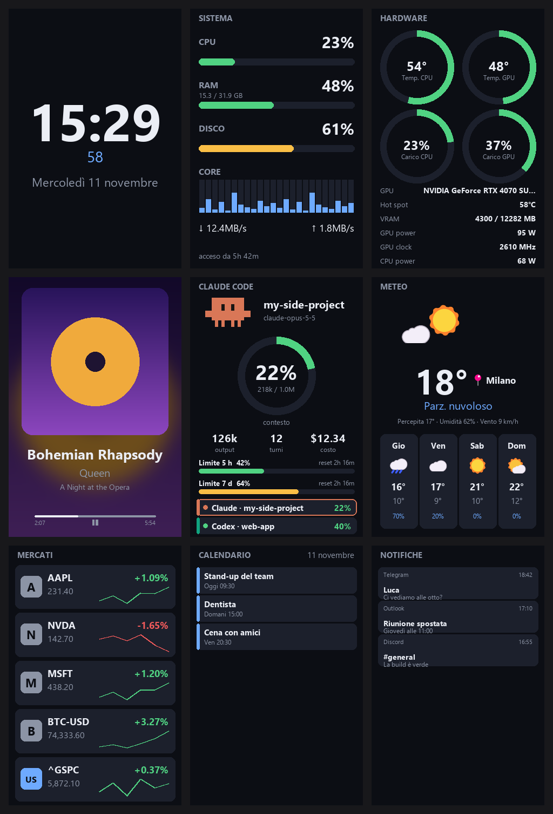
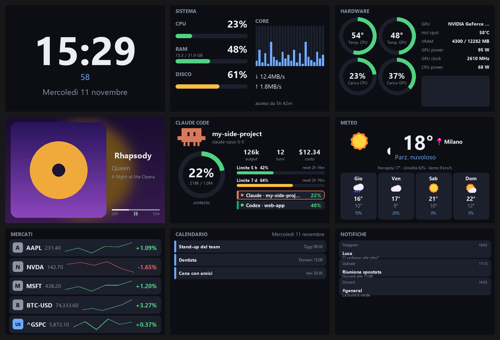

# Turing Screen Studio

**Turn the little 3.5" USB screen on your desk into a live dashboard you design yourself.**

Turing Screen Studio replaces the stock *UsbMonitor / TURZX* software of the **Turing Smart Screen 3.5"**
with an open, Python-based app: pages built from widgets with a drag & drop editor, live data from your PC
and the web, smooth partial updates, and themes you can share.



<details>
<summary><b>Same pages in landscape</b></summary>



</details>

<sub>Screenshots rendered from the bundled layouts with demo data, dark theme, Italian UI.</sub>

## What's on the screen

| Page | Shows |
|---|---|
| 🕒 **Clock** | time, seconds, date |
| 💻 **System** | CPU, RAM, disk, per-core load, network speed, uptime |
| 🌡️ **Hardware** | CPU / GPU temperature, load, power, clocks, VRAM (LibreHardwareMonitor) |
| 🎵 **Media** | what Spotify / the browser / any Windows player is playing, with cover and progress |
| 🤖 **Claude Code / Codex** | one page per live session: context used, output tokens, turns, cost, plan limits |
| ⛅ **Weather** | animated current weather and 4-day forecast for any city (Open-Meteo, no API key) |
| 📈 **Markets** | stocks, ETFs and crypto with logos and sparklines (Yahoo Finance) |
| 📅 **Calendar** | upcoming events from Google Calendar / Outlook iCal links |
| 🔔 **Notifications** | the latest Windows notifications |

Pages with nothing to show (no media playing, no AI session) are skipped automatically.
Don't like a page? Open the editor and change it, or start one from scratch.

## Features

- **Drag & drop page editor**: move, resize, multi-select, group, alignment guides, undo,
  separate portrait and landscape layouts, "show on screen" to preview live.
- **Widgets**: text with live fields, bars, rings, sparklines, per-core graphs, images, animated
  GIF / APNG / WebP, scrolling text, animated weather (sun, clouds, rain, snow, lightning, fog).
- **Themes** (colours, fonts, per-page backgrounds) and **pages** export to `.tss-theme` / `.tss-page`
  files to share with others.
- **Lives in the tray**: switch page, brightness, settings; starts at sign-in.
- **Page hotkeys**: `Ctrl+Shift+→` / `Ctrl+Shift+←` (configurable), or automatic rotation.
- **Smart power**: screen off when the PC is locked, goes to sleep or shuts down; dimmer brightness at night.
- **Everything applies live**: edit a layout, a theme or a setting and the screen follows within a second.
- **Italian and English UI**, switchable in the settings.

## Requirements

- Windows 10 / 11
- A **Turing Smart Screen 3.5" rev. A** (USB `1A86:5722`, serial `USB35INCHIPSV2`, shows up as a COM port)
- Python 3.12 to run from source
- Optional, for CPU temperatures and power: administrator rights and the
  [PawnIO](https://pawnio.eu/) driver used by LibreHardwareMonitor

> Close `UsbMonitor.exe` first: only one program can talk to the screen at a time.

## Quick start

```powershell
git clone https://github.com/sickmazin/Turing-Screen-Studio.git
cd Turing-Screen-Studio
py -3.12 -m venv .venv
.venv\Scripts\pip install -r requirements.txt
.venv\Scripts\python tools\fetch_lhm.py      # downloads LibreHardwareMonitorLib into vendor\lhm
.venv\Scripts\python main.py                 # screen app (tray icon)
.venv\Scripts\python settings.py             # settings window and page editor
```

The screen port is found automatically. Your settings, layouts and themes live in
`%APPDATA%\TuringScreenStudio` (the repo's `defaults/` only seeds that folder on first run), so updating the
app never overwrites your pages.

### Build the .exe

```powershell
.venv\Scripts\pip install -r requirements-dev.txt
.venv\Scripts\python tools\build.py
```

Output: `dist\TuringScreenStudio\TuringScreenStudio.exe` (one folder, asks for administrator rights).
`TuringScreenStudio.exe --settings` opens the settings window. `tools\build.py` builds into `build\fresh` and
swaps `dist` only when no running copy of the app is using it.

### Tests

```powershell
.venv\Scripts\python -m unittest discover -s tests -t .
```

The layout tests render every bundled page in both orientations and both languages with long values, and fail
if a widget errors, leaves the screen or truncates a number.

## Make it yours

### Live fields

Any text widget can mix fixed text and live fields written as `{path:format}`:

```text
{system.cpu:.0f}%        →  23%
{hardware.gpu.temp:.0f}° →  48°
{stocks.0.price:,.2f}    →  231.40
{claude.0.context_pct:.0f}%
{now:%H:%M}              →  15:29
```

Extra formats: `mmss`, `hm`, `human`, `bytes`, `gb`, `weather`, `weekday`, `reset`, `hide`.
You don't need to remember any of this: the editor lists every available field with its current value.

### Add a data source

Drop a file in `sources/` with four names and it shows up everywhere:

```python
name = "example"
settings = {"city": "Milano"}   # defaults, editable in the settings' Data tab
interval = 60                   # seconds between refreshes

async def fetch(cfg):
    return {"value": 42}        # available in widgets as {example.value}
```

Pages can also be written in Python in `pages/` (`name`, `needs`, `render(state, size, cfg)`) when a layout
isn't enough.

### Claude Code status line (optional)

Cost, real context size and plan limits come from Claude Code's status line. In `~/.claude/settings.json`:

```json
"statusLine": {"type": "command", "command": "C:/<path>/.venv/Scripts/python.exe C:/<path>/claude_statusline.py"}
```

Use forward slashes: on Windows Claude Code runs the command through Git Bash, where backslashes are escapes.

## How it works

| Path | What |
|---|---|
| `main.py` | screen app: loop, live reload, partial updates, tray |
| `screen.py` | serial protocol of the rev. A screen (6-byte commands, RGB565 little-endian) |
| `layout.py`, `widgets.py` | layout pages and the widget library |
| `sources/*.py` | data sources |
| `pages/*.py` | optional pages written in Python |
| `settings.py`, `editor.py` | settings window and page editor (Tkinter) |
| `i18n.py` | translations (add a language by adding a table) |
| `defaults/` | config, layouts and themes copied to the data folder on first run |
| `tools/` | build script, default layout generator, preview renderer, LHM downloader, translation checker |

**Why only part of the screen updates:** the screen accepts about 157 KB/s, so a full 320×480 frame takes
~2 s. Each tick only the rectangle that changed is sent: a ticking clock costs ~40 ms, and animations run as
fast as their area allows (a 200×110 weather animation runs at ~3–4 fps).

## Roadmap

- [ ] **Page rules**: show a page when a condition holds (Claude page while a session is working,
      weather only in the morning, media page only while playing).
- [ ] **Tablet / smartphone as a screen**: a network display backend next to `screen.py` (local web server,
      frames over WebSocket to a browser page, nothing to install), no USB bandwidth limit, 20–30 fps animations.
- [ ] **New pages**:
  - [ ] **Inbox**: latest unread emails (Gmail / Outlook) with sender and subject.
  - [ ] **App notifications**: a page that follows a single app (e.g. only Telegram or only Discord).
  - [ ] **Connected devices**: status bar with Bluetooth headphones, mouse, keyboard and controller,
        battery level included.
- [ ] Disk temperatures and fan curves on the hardware page.
- [ ] Installer (Inno Setup) on top of the PyInstaller folder.
- [ ] More languages.

## Credits and licences

Turing Screen Studio is released under the [MIT licence](LICENSE): use it, modify it and share it freely,
keeping the copyright notice and a link to [the original project](https://github.com/sickmazin/Turing-Screen-Studio).

- LibreHardwareMonitorLib (MPL-2.0) is downloaded from its official release, not stored in this repository.
- The screen protocol was reimplemented from the documented behaviour of
  [turing-smart-screen-python](https://github.com/mathoudebine/turing-smart-screen-python) (GPL-3.0); no code is copied.
- Weather by [Open-Meteo](https://open-meteo.com/), market data by Yahoo Finance, ticker logos from
  [ticker-logos](https://github.com/davidepalazzo/ticker-logos).

Not affiliated with Turing / TURZX.
